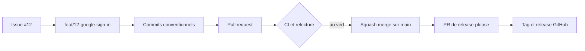

<p align="right"><a href="./README.md">English</a> | <b>Français</b></p>

<h1 align="center">github-forge</h1>

<p align="center">
  <b>Tenez chaque dépôt comme une équipe pro : commits conventionnels, pull requests relues, main protégée, releases, et rien qui dise qu'une IA a écrit le code.</b>
</p>

<p align="center">
  <a href="https://github.com/thmsgo18/github-forge/releases"></a>
  <a href="LICENSE"></a>
  <a href="https://github.com/thmsgo18/github-forge/actions/workflows/ci.yml"></a>
  <br>
  
  
  
  
</p>

<p align="center">
  <a href="#installation">Installation</a> •
  <a href="#ce-que-fait-le-skill">Ce que fait le skill</a> •
  <a href="#exemple">Exemple</a> •
  <a href="#fonctionnement">Fonctionnement</a> •
  <a href="#contribuer">Contribuer</a>
</p>

---

<p align="center">
  
</p>

La plupart des dépôts perso ou étudiants dérivent de la même façon : des commits nommés « update », du travail poussé directement sur `main`, pas de CI, des réglages laissés par défaut, et parfois un assistant IA affiché parmi les contributeurs. github-forge est un skill Claude Code qui installe un dépôt proprement une fois, puis fait passer chaque tâche par le même chemin professionnel : issue, branche, commits conventionnels, pull request, CI au vert, squash merge.

Il explique chaque commande Git en une ligne avant de la lancer : vous apprenez le workflow pendant qu'il fait le travail. Il demande avant tout ce qui sort de votre machine.

> [!NOTE]
> Le skill vous parle en français. Les commits, pull requests et issues suivent la langue de chaque dépôt : l'anglais pour un dépôt neuf, le français quand l'historique l'est déjà.

## Installation

En skill personnel, disponible dans tous vos projets :

```bash
git clone https://github.com/thmsgo18/github-forge.git ~/.claude/skills/github-forge
```

Ou pour un seul dépôt :

```bash
git clone https://github.com/thmsgo18/github-forge.git .claude/skills/github-forge
```

Il vous faut `git`, la [GitHub CLI](https://cli.github.com/) connectée avec les scopes `repo` et `workflow`, et `python3`. À la première tâche Git d'une conversation, le skill lance `scripts/doctor.sh` et vous dit ce qu'il faut corriger sur votre machine.

## Ce que fait le skill

- **Installe un nouveau dépôt** : licence, README, CONTRIBUTING, modèles de PR et d'issue, CODEOWNERS, Dependabot, CI adaptée à la stack (Node, Python, Java, LaTeX, Rust, Tauri), hooks de commit, puis réglages GitHub et protection de branche, dans le bon ordre.
- **Audite un dépôt existant** : une checklist avec un score, classée par gravité, puis les corrections par une pull request.
- **Mène le cycle quotidien** : retrouve ou ouvre l'issue, nomme la branche, écrit des Conventional Commits, ouvre la PR, suit la CI, fusionne en squash et fait le ménage.
- **Travaille en équipe** : invitations, CODEOWNERS, relectures obligatoires, commentaires de relecture rédigés pour que vous les validiez, ordre de fusion des pull requests liées.
- **Publie des versions** : numéros SemVer et changelog avec release-please, à partir des commits que vous écrivez déjà.
- **Vous sort des mauvais pas** : conflits, commits sur la mauvaise branche, secret poussé, commit perdu, hook ou CI qui échoue.
- **Garde votre profil à vous** : pas de trailer `Co-Authored-By`, pas de ligne « Generated with », pas de dossier `.claude/` sur GitHub, vérifié avant chaque push.

Dépôt privé en offre gratuite, où GitHub refuse la protection de branche ? Le skill dit quelle offre manque et pose une garde locale à la place : des hooks Git qui refusent les commits et les push sur `main`.

## Exemple

Un vrai échange :

```text
Vous :  commence la tâche pour ajouter la connexion Google

Claude : → Je mets main à jour avant de créer la branche, pour partir de la dernière version du code.
           $ git switch main && git pull
         → Aucune issue ne correspond : j'ouvre la #12 « Add Google sign-in » et je te l'assigne.
           $ gh issue create --title "Add Google sign-in" --label enhancement --assignee @me
         → Je crée la branche feat/12-google-sign-in, liée à l'issue #12, pour isoler ce travail.
           $ git switch -c feat/12-google-sign-in
```

Dites « mode expert » pour supprimer les explications et ne garder que les confirmations avant les fusions, suppressions et force-push.

## Fonctionnement



`SKILL.md` contient les règles et oriente chaque situation vers un guide de `references/` : configuration de la machine, installation d'un dépôt, audit, cycle d'une tâche, équipe, Dependabot, releases, dépannage. Les modèles sont dans `assets/`, et les réglages que seul un script peut appliquer sont dans `scripts/` :

| Script | Rôle |
|---|---|
| `doctor.sh` | Vérifie la machine : connexion et scopes de `gh`, identité Git, signature, gitignore global, attribution IA désactivée, dossier de travail hors d'iCloud |
| `configure-repo.sh OWNER/REPO` | Fusion en squash seule, titre de PR comme message de commit, branches supprimées après fusion, alertes de sécurité, workflows en lecture seule |
| `protect-main.sh OWNER/REPO solo\|team [CHECK...]` | Crée le ruleset « Protect main » : pull request obligatoire, CI obligatoire, pas de force-push |
| `audit-repo.py [OWNER/REPO]` | La checklist et le score montrés plus haut |
| `check-no-ai-trace.py` | Repère toute attribution à une IA dans les commits, noms de branche, noms de fichier ou corps de PR |

<details>
<summary>Conventions appliquées dans chaque dépôt</summary>

| Élément | Règle |
|---|---|
| Workflow | GitHub Flow : `main` plus une branche courte par tâche |
| Branche | `<type>/<issue>-<slug>`, par exemple `feat/12-google-sign-in` |
| Commit et titre de PR | Conventional Commits, par exemple `feat(auth): add Google sign-in` |
| Fusion | Squash and merge uniquement, branche supprimée automatiquement |
| Versions | SemVer : `fix` donne un correctif, `feat` une version mineure, `!` une majeure |

</details>

## Projets liés

- [readme-forge](https://github.com/thmsgo18/readme-forge) : le skill qui a écrit ce README, appelé par github-forge quand un dépôt en a besoin.

## Contribuer

Les signalements de bugs et les pull requests sont bienvenus, voir [CONTRIBUTING.md](CONTRIBUTING.md). Problèmes de sécurité : voir [SECURITY.md](SECURITY.md).

## Licence

[MIT](LICENSE) © Thomas Gourmelen

## Auteur

Réalisé par [thmsgo18](https://github.com/thmsgo18)
