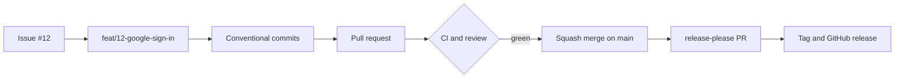

<p align="right"><b>English</b> | <a href="./README.fr.md">Français</a></p>

<h1 align="center">github-forge</h1>

<p align="center">
  <b>Run every repository like a professional team: conventional commits, reviewed pull requests, a protected main, releases, and nothing that says an AI wrote it.</b>
</p>

<p align="center">
  <a href="https://github.com/thmsgo18/github-forge/releases"></a>
  <a href="LICENSE"></a>
  <a href="https://github.com/thmsgo18/github-forge/actions/workflows/ci.yml"></a>
  <br>
  
  
  
  
</p>

<p align="center">
  <a href="#install">Install</a> •
  <a href="#what-it-does">What it does</a> •
  <a href="#example">Example</a> •
  <a href="#how-it-works">How it works</a> •
  <a href="#contributing">Contributing</a>
</p>

---

<p align="center">
  
</p>

Most solo and student repositories drift the same way: commits named "update", work pushed straight to `main`, no CI, settings left at their defaults, and sometimes an AI assistant listed as a contributor. github-forge is a Claude Code skill that sets a repository up properly once, then keeps every task on the same professional path: issue, branch, conventional commits, pull request, green CI, squash merge.

It explains each Git command in one line before running it, so you learn the workflow while it does the work. It asks before anything leaves your machine.

> [!NOTE]
> The skill talks to you in French. Commits, pull requests and issues follow the language of each repository: English for a new one, French when the history already is.

## Install

As a personal skill, available in every project:

```bash
git clone https://github.com/thmsgo18/github-forge.git ~/.claude/skills/github-forge
```

Or only for one repository:

```bash
git clone https://github.com/thmsgo18/github-forge.git .claude/skills/github-forge
```

You need `git`, the [GitHub CLI](https://cli.github.com/) logged in with the `repo` and `workflow` scopes, and `python3`. On the first Git task of a conversation, the skill runs `scripts/doctor.sh` and tells you what to fix on your machine.

## What it does

- **Sets up a new repository**: license, README, CONTRIBUTING, PR and issue templates, CODEOWNERS, Dependabot, CI for your stack (Node, Python, Java, LaTeX, Rust, Tauri), commit hooks, then GitHub settings and branch protection in the right order.
- **Audits an existing one**: a checklist with a score, sorted by severity, then the fixes through a pull request.
- **Runs the daily cycle**: finds or opens the issue, names the branch, writes Conventional Commits, opens the PR, follows the CI, squash merges and cleans up.
- **Works in a team**: invites, CODEOWNERS, required reviews, review comments drafted for you to approve, merge order for linked pull requests.
- **Ships releases**: SemVer versions and a changelog with release-please, from the commits you already write.
- **Gets you out of trouble**: conflicts, commits on the wrong branch, a pushed secret, a lost commit, a failing hook or CI.
- **Keeps your profile yours**: no `Co-Authored-By` trailer, no "Generated with" line, no `.claude/` folder on GitHub, checked before every push.

Private repository on a free plan, where GitHub refuses branch protection? The skill says which plan is missing and installs a local guard instead: Git hooks that refuse commits and pushes to `main`.

## Example

A real exchange, in the French the skill speaks:

```text
You:    commence la tâche pour ajouter la connexion Google

Claude: → Je mets main à jour avant de créer la branche, pour partir de la dernière version du code.
          $ git switch main && git pull
        → Aucune issue ne correspond : j'ouvre la #12 « Add Google sign-in » et je te l'assigne.
          $ gh issue create --title "Add Google sign-in" --label enhancement --assignee @me
        → Je crée la branche feat/12-google-sign-in, liée à l'issue #12, pour isoler ce travail.
          $ git switch -c feat/12-google-sign-in
```

Say « mode expert » to drop the explanations and keep only the confirmations before merges, deletions and force-pushes.

## How it works



`SKILL.md` holds the rules and routes each situation to one guide in `references/`: machine setup, repository setup, audit, task cycle, team, Dependabot, releases, troubleshooting. Templates live in `assets/`, and the settings that only a script can apply are in `scripts/`:

| Script | What it does |
|---|---|
| `doctor.sh` | Checks the machine: `gh` login and scopes, Git identity, signing, global gitignore, AI attribution turned off, working folder outside iCloud |
| `configure-repo.sh OWNER/REPO` | Squash-only merges, PR title as commit message, branches deleted after merge, security alerts, read-only workflows |
| `protect-main.sh OWNER/REPO solo\|team [CHECK...]` | Creates the "Protect main" ruleset: pull request required, CI required, no force-push |
| `audit-repo.py [OWNER/REPO]` | The checklist and score shown above |
| `check-no-ai-trace.py` | Finds AI attribution in commits, branch names, file names, or a PR body |

<details>
<summary>Conventions applied in every repository</summary>

| Item | Rule |
|---|---|
| Workflow | GitHub Flow: `main` plus one short branch per task |
| Branch | `<type>/<issue>-<slug>`, for example `feat/12-google-sign-in` |
| Commit and PR title | Conventional Commits, for example `feat(auth): add Google sign-in` |
| Merge | Squash and merge only, branch deleted automatically |
| Versions | SemVer: `fix` gives a patch, `feat` a minor, `!` a major |

</details>

## Related

- [readme-forge](https://github.com/thmsgo18/readme-forge): the skill that wrote this README, called by github-forge when a repository needs one.

## Contributing

Bug reports and pull requests are welcome, see [CONTRIBUTING.md](CONTRIBUTING.md). Security issues: see [SECURITY.md](SECURITY.md).

## License

[MIT](LICENSE) © Thomas Gourmelen

## Author

Made by [thmsgo18](https://github.com/thmsgo18)
